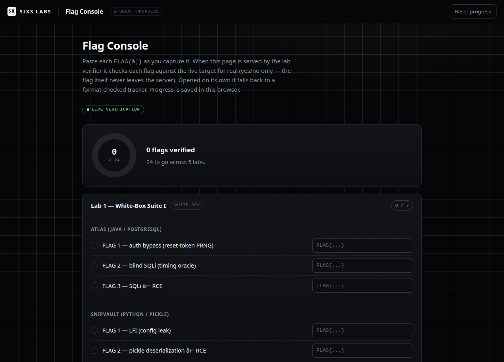
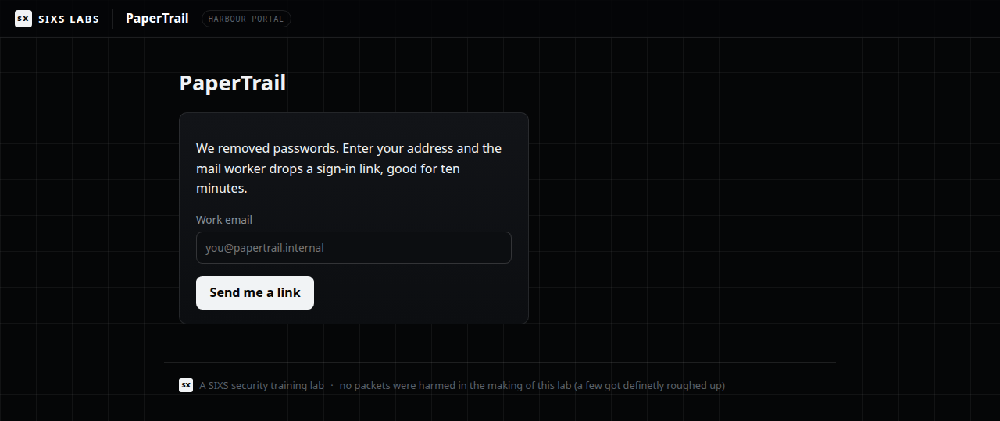
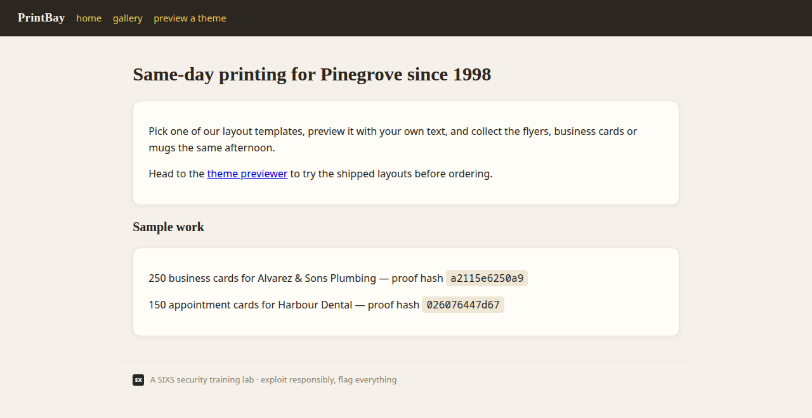

<div align="center">

# SIXS Web Security Labs

This was me trying to prep myself for the infamous OSWE exam. To give myself a
lightweight lab where I my own skills could trial, I built from scratch a set of
challenges that trial variations of the exploitation techniques taught in the
course. I extensively used GLM5.3 (to not spoil the surprises for myself) to build
the challenges -- something I would recommend you doing as well (great fun!)

A collection of deliberately vulnerable web applications for hands-on
web-application security training - recon, source auditing, exploit
developement and full exploit chains, in the style of advanced web-security
certifications (OSWE / WEB-300).

</div>

---

> ### These applications are intentionally insecure
>
> Every app in this repository contains real, exploitable vulnerabilities **by
> design**. Run them **only** on an isolated host or local machine you control.
> **Never deploy them on a public network, a shared server, or anywhere
> reachable from the internet.** They are for education and authorised security
> testing only. You are responsible for how you use them.

## Screenshots

The **flag console** checks every flag against the live targets for real
(yes/no only, the flag value itself never leaves the server) and keeps your
progress per lab and overall:

<p align="center">
  
</p>

And a couple of the targets themselves, each shipped as full source to audit -
one dark, one light, because the vulnerabilitys come in every theme:

<p align="center">
  
  
</p>

## The labs

| Lab                                            | Theme                                                   | Style                   | Stacks                                                   | Ports         |
| ---------------------------------------------- | ------------------------------------------------------- | ----------------------- | -------------------------------------------------------- | ------------- |
| [`lab-1-whitebox-suite`](lab-1-whitebox-suite) | White-Box Suite I - ATLAS · SnipVault · ReportSmith     | White-box · 3 services  | Java/Spring+PostgreSQL · Flask+pickle · Node/Express+EJS | `8081`-`8083` |
| [`lab-2-whitebox-suite`](lab-2-whitebox-suite) | White-Box Suite II - FleetLedger · CaseForge · PrintBay | White-box · 3 services  | Java/Spring+PostgreSQL · Flask+Jinja2 · PHP+SQLite       | `8084`-`8086` |
| [`lab-3-papertrail`](lab-3-papertrail)         | PaperTrail (Boss Lab I)                                 | White-box · fused chain | Python / Flask (portal + internal intranet)              | `8088`        |
| [`lab-4-harbordock`](lab-4-harbordock)         | HarborDock + DockOps (Boss Lab II)                      | White-box · fused chain | Java/Spring+PostgreSQL · Node/Express+EJS                | `8089`-`8090` |
| [`lab-5-tidegate`](lab-5-tidegate)             | TideGate (Boss Lab III)                                 | White-box · fused chain | PHP+SQLite (XML manifest gateway)                        | `8091`        |
| [`lab-6-whitebox-suite`](lab-6-whitebox-suite) | White-Box Suite III - FareDesk · TrackSide · SignalBox · CrewRoom | White-box · 4 services | Perl/Mojolicious + SQLite, Node/Express + jsdom bot | `8092`-`8095` |

Each lab has its own `README.md` with objectives, ground rules and a
walkthrough of what every flag trains.

## Quick start

**Everything at once.** A central [`docker-compose.yml`](docker-compose.yml) at
the repository root brings up all six labs together (it pulls in each lab's
own compose via `include`, so the two never drift). Ports are disjoint, so the
whole range runs side by side:

```bash
docker compose up --build -d      # build + start every lab
docker compose ps                 # all services and their ports
docker compose down               # stop everything
```

On a host whose Docker daemon cannot reach the internet from the default bridge
during a build, run `./build-all.sh` instead (host-network builds, then start).

**One lab at a time.** Each lab is also self-contained. Pick one and bring it up:

```bash
cd lab-1-whitebox-suite
docker compose up --build -d      # or ./build.sh for the boss labs
docker compose logs -f            # watch startup
docker compose down               # stop (flags re-roll on restart)
```

**Requirements:** Docker with the Compose plugin.

## How the labs are meant to be used

The labs are white-box: the full source ships with each app. Audit it,
find the bugs, and write a standalone, argument-driven exploit for each flag.
Flags are minted fresh on every container start, so a flag only counts once
your own script has printed it.

> ** Spoilers.** Each lab ships a tiered `hints/` directory
> (nudge -> strong hint -> answer) and a `solutions/` directory with full
> walkthroughs and reference exploits. Stay out of them until you have the flag,
> or you are giving the exercise away.

## Track your progress

A minimalist flag-submission panel tracks all flags per lab and overall. It runs
in two modes:

- **Live verification (recommended).** When the central stack is up, a small
  `verifier` service serves the panel at **http://localhost:8099** and checks
  each flag against the running targets for real. It only ever reads SHA-256
  digests of the current run's flags from a shared volume (each lab's entrypoint
  writes them at start), hashes what you submit, and answers yes/no - the flag
  value itself never leaves the target, so nothing is spoiled.
- **Offline tracker.** Opening [`flag-console/index.html`](flag-console/index.html)
  directly (no stack running) falls back to a format-checked progress tracker.

Either way, progress is saved in that browser only.

## Repository layout

```
lab-N-<name>/
├── README.md            objectives, ground rules, what each flag trains
├── docker-compose.yml   the lab's services
├── <app>/               one directory per vulnerable application (full source)
├── hints/               tiered hints
├── solutions/           reference walkthroughs + exploits
└── exploits/            your workspace - write your own exploit scripts here
assets/                  shared SIXS visual identity (sixs-lab.css)
flag-console/            student flag-submission / progress panel (open in a browser)
```

## License

Released under the [MIT License](LICENSE). The intentionally vulnerable code is
provided for educational and authorised-testing purposes only, without warranty
of any kind.

---

<div align="center">
A <strong>SIXS</strong> Project. Built to be broken, so when it breaks it is
working as intended.
</div>
